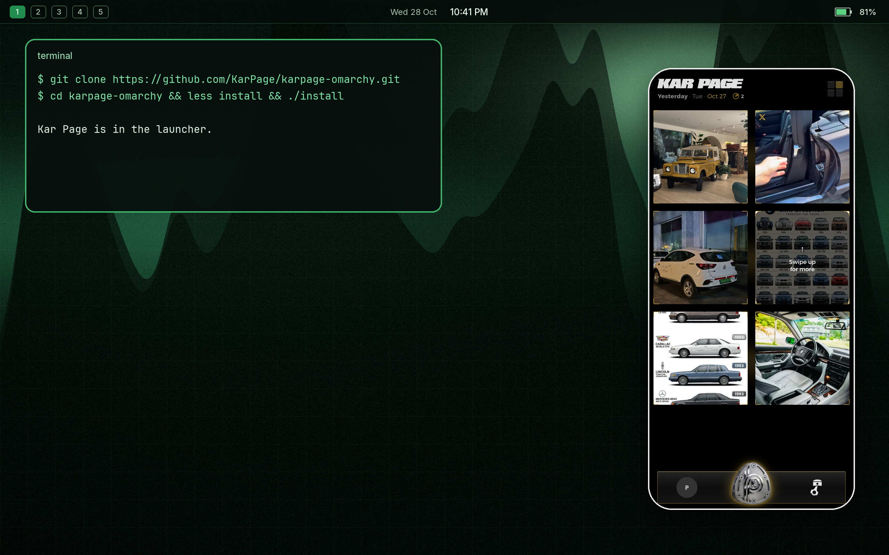
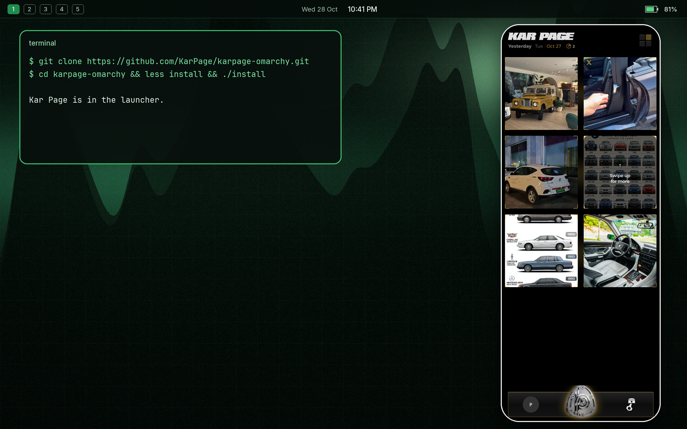
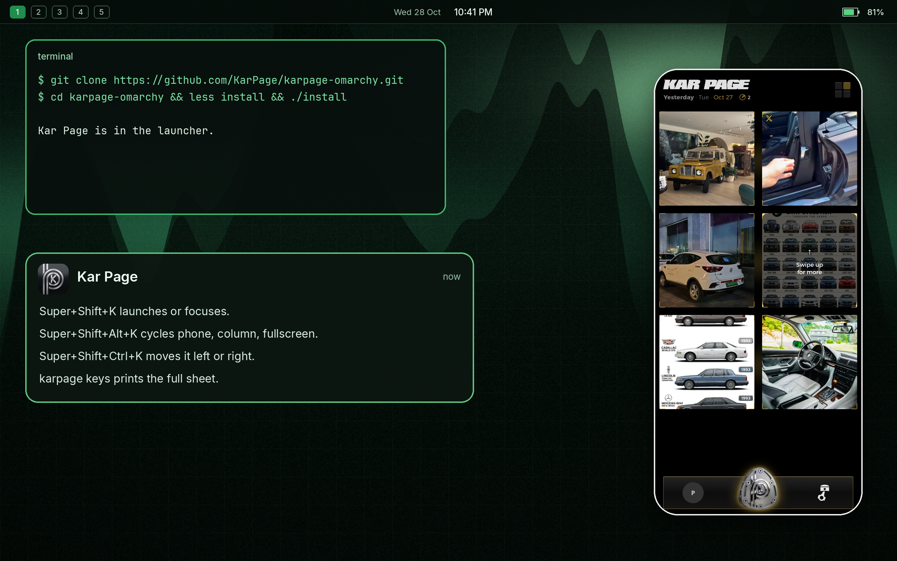

# Kar Page for Omarchy

Launcher for [Kar Page](https://karpage.app) on Omarchy. It opens the live site as one floating phone window on Hyprland. This repo is the launcher. The Kar Page app source is not here.

## Install

Paste this into a terminal on Omarchy. `less` shows the script first. Press `q` to install, or Ctrl-C to stop.

```bash
git clone https://github.com/KarPage/karpage-omarchy.git && cd karpage-omarchy && less install && ./install
```

## Upgrade

From this directory:

```bash
git pull && less install && ./install
```

Running `./install` again replaces only the marked Kar Page block. The rest of `hyprland.conf` or `hyprland.lua` stays as it is. A symlink is left alone.

## What install does

`./install` runs as your user. It does not use sudo, install packages, open the network, or send telemetry.

It copies:

- `~/.local/bin/karpage`
- `~/.local/share/applications/karpage.desktop`
- `~/.local/share/icons/hicolor/512x512/apps/karpage.png`
- `~/.config/hypr/karpage.conf` and `~/.config/hypr/karpage.lua`
- `~/.config/hypr/karpage_binds.lua` and `~/.config/hypr/karpage-binds.conf` (present, not loaded)
- `~/.config/karpage/config` when that file is missing

On Omarchy 3 it appends this block to the bottom of `~/.config/hypr/hyprland.conf`, with your home directory filled in:

```
# karpage-omarchy:begin
source = /home/you/.config/hypr/karpage.conf
# karpage-omarchy:end
```

On Omarchy 4 it appends this block to `~/.config/hypr/hyprland.lua`:

```
-- karpage-omarchy:begin
require("hypr.karpage")
-- karpage-omarchy:end
```

The rules match the Kar Page window class (`karpage`, and the Chromium app classes for karpage.app). They float it, size it to 430×932, round the corners, and draw a 2px bezel. The launcher then fits that phone to the focused monitor. The default side is the right edge, with a 48px margin. Edit `~/.config/karpage/config` and run `karpage rules` to change the size, side, rounding, or opacity.

## Shortcuts

Install prints these. It does not bind them. Omarchy uses Super+K for its keybindings menu, so the suggested Kar Page keys sit beside that key.

| Keys | Action |
| --- | --- |
| Super+Shift+K | Launch the phone window, or focus it |
| Super+Shift+Alt+K | Cycle phone, side column, fullscreen |
| Super+Shift+Ctrl+K | Move the window left or right |

The first launch also sends a notification with this list. `karpage keys` prints it again.

To load the binds, add one line yourself.

Omarchy 3, at the bottom of `~/.config/hypr/hyprland.conf`:

```
source = ~/.config/hypr/karpage-binds.conf
```

Omarchy 4, at the bottom of `~/.config/hypr/hyprland.lua`:

```lua
require("hypr.karpage_binds")
```

`karpage-binds.conf` includes a commented Super+K set, for a config that gives that key to Kar Page.

## Commands

| Command | Action |
| --- | --- |
| `karpage` | Launch the phone window, or focus the one already open |
| `karpage toggle` | Cycle phone, side column, fullscreen |
| `karpage mode phone` | Floating phone |
| `karpage mode tile` | Side column, full height, on the configured side |
| `karpage mode full` | Fullscreen |
| `karpage side left` | Move to the left |
| `karpage side right` | Move to the right |
| `karpage side center` | Center the phone |
| `karpage side toggle` | Swap left and right |
| `karpage --browser NAME` | Use one browser for this launch |
| `karpage rules` | Rewrite the Hyprland rules from the config |
| `karpage keys` | Print the shortcut sheet |
| `karpage --help` | Browsers, files, and Firefox limits |

`karpage mode` and `karpage side` with no argument print the current value.

The side column is a floating window docked to the screen edge. The other windows on the desktop stay where they are. Set `pin=yes` in the config to keep that column on every workspace.

## Browsers

Auto-detect tries Chromium, Google Chrome, Brave, Vivaldi, Microsoft Edge, then Firefox. Set `browser=` in the config, or pass `--browser chromium` (also `chrome`, `brave`, `vivaldi`, `edge`, `firefox`). A named browser that is missing produces a message, then Kar Page tries the rest. When none of them are on PATH, the message includes `sudo pacman -S chromium`.

Chromium-based browsers open with `--app=https://karpage.app`, `--class=karpage`, and their own `--user-data-dir`.

Each browser has a profile under `~/.local/share/karpage/browsers/`. Sign in there. That profile is separate from everyday browsing, so a sign-in in your normal Chrome window stays there.

Firefox has no app-window flag. Kar Page opens `--new-window` in its own profile, so the toolbar stays and the class stays `firefox`. The launcher finds that profile's window and frames it. Kiosk mode stays unused, because it is fullscreen only. A Firefox window you already had open stays as it is.

## Config

`~/.config/karpage/config` is the file `config.example` starts from. One `KEY=value` per line. No secrets.

| Key | Default | Meaning |
| --- | --- | --- |
| `browser` | `auto` | `auto`, `chromium`, `chrome`, `brave`, `vivaldi`, `edge`, or `firefox` |
| `url` | `https://karpage.app` | https address to open |
| `side` | `right` | `left`, `right`, or `center` |
| `mode` | `phone` | `phone`, `tile`, or `full` |
| `opacity` | `1.0` | `0.85` to `1` |
| `phone_width` | `430` | Logical phone width |
| `phone_height` | `932` | Logical phone height |
| `margin` | `48` | Gap from the screen edge. Short monitors use a smaller gap |
| `rounding` | `46` | Corner radius |
| `border_size` | `2` | Bezel width |
| `pin` | `no` | `yes` keeps the side column on every workspace |

A mode or side you set from the command line is remembered until the config file is newer.

## Remove

From this directory:

```bash
./uninstall
```

That removes the binary, desktop entry, icon, Hyprland files, and the marked block. It leaves these in place, because they can hold a sign-in:

- `~/.config/karpage/config`
- `~/.local/share/karpage/browsers/`

## Previews

Mock Omarchy desktop. The phone shows the public [karpage.app](https://karpage.app) feed, with no account.







`previews/modes.webm` and `previews/modes.gif` show the launch and the mode keys.

## Checks

```bash
shellcheck -s bash karpage tests/launcher.sh
shellcheck -s sh install uninstall
bash tests/launcher.sh
```

The desktop entry, the icon, the scripts, and the Hyprland files are the launcher. MIT license. The window shows whatever is deployed at https://karpage.app.
